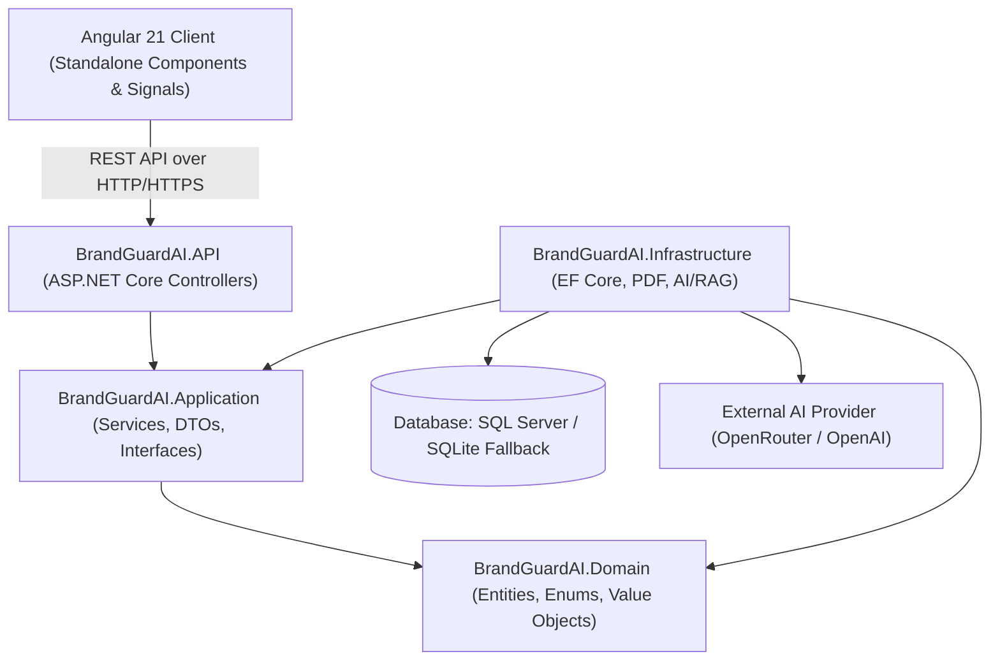
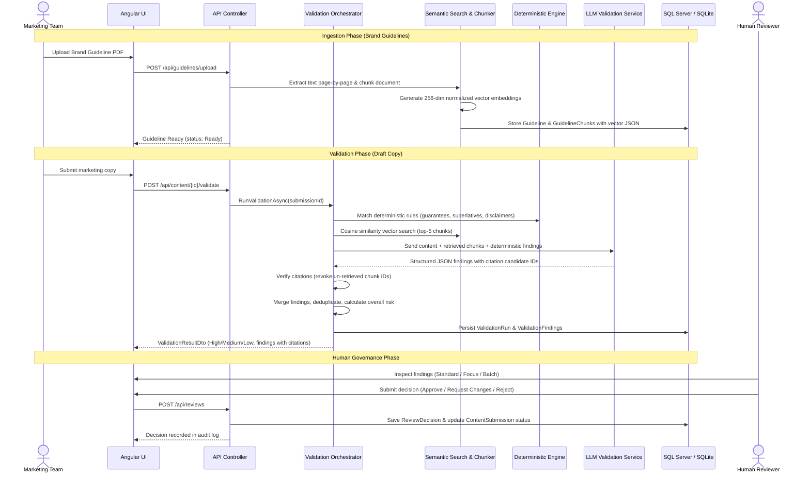
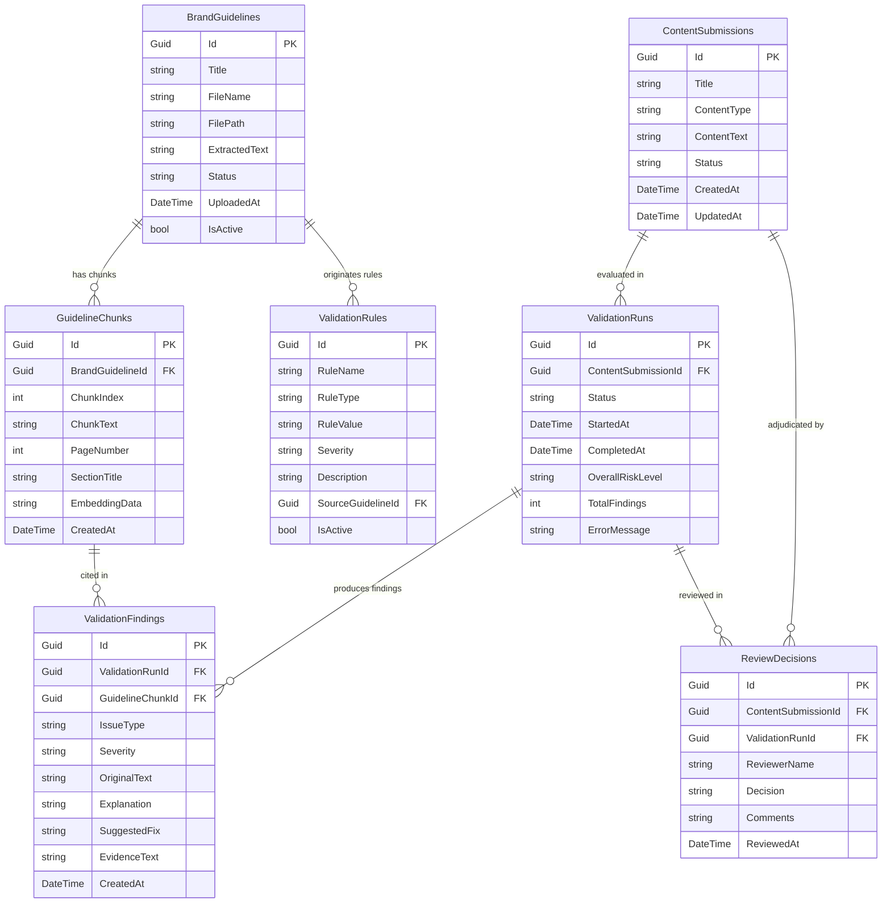

# BrandGuard AI &mdash; System Architecture & Technical Design

## 1. High-Level Architecture Overview

BrandGuard AI is structured following Clean Architecture principles, ensuring modular separation of concerns between API endpoints, business logic, persistence, and external integrations.



---

## 2. Solution Structure

```
BrandGuardAI/
├── BrandGuardAI.API/               # REST API Controllers, Middleware, CORS, Swagger
├── BrandGuardAI.Application/       # Core business interfaces, models, and service contracts
├── BrandGuardAI.Domain/            # Pure domain entities, enums, and lifecycle definitions
├── BrandGuardAI.Infrastructure/    # EF Core, PDF extraction, vector embeddings, RAG, and AI integration
├── BrandGuardAI.Tests/             # Unit and integration test suites
├── brandguard-ui/                  # Angular standalone frontend application
├── docs/                           # Architecture, guides, testing reports, and progress documents
├── samples/                        # Demonstration guideline PDFs and sample test files
└── README.md
```

---

## 3. The Retrieval-Augmented Generation (RAG) Pipeline

The RAG workflow transforms unstructured brand policy documents into structured, cited compliance findings:



---

## 4. Entity Relationship Diagram



---

## 5. Security & Reliability Highlights

1. **Parameterization:** All database operations utilize EF Core parameterized queries, preventing SQL injection.
2. **File Validation:** PDF uploads are restricted to `.pdf` extension, validated for binary stream integrity, and capped at 25MB.
3. **Evidence Anti-Hallucination:** Every chunk cited in LLM output is programmatically verified against the in-memory dictionary of retrieved chunks. If an ID was fabricated, the citation is revoked to prevent phantom evidence.
4. **Idempotency Protection:** Consecutive duplicate review decisions submitted within 15 seconds are intercepted, returning the existing decision without creating redundant database records.
5. **Database Resilience:** Automated fallback between SQL Server and SQLite ensures zero environmental startup failures.
